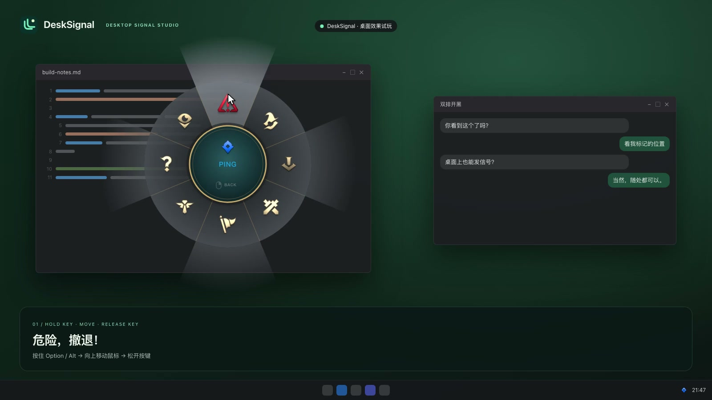

<div align="center">

<h1>LOL Pings-DeskSignal-App</h1>
<p><strong>English</strong> · <a href="README.zh-CN.md">简体中文</a></p>
<p><strong>Desktop signals, emotes and sound—one key away.</strong><br>
Hold Option / Alt for pings, or Control / Ctrl for emotes.<br>
Move to choose. Release or click to send. No mouse hold needed.</p>
<p>
  <a href="https://github.com/xiaoyu607/LOL-Pings-DeskSignal-App/actions/workflows/ci.yml"></a>
  <a href="package.json"></a>
  <a href="LICENSE"></a>
</p>
<p><strong><a href="https://github.com/xiaoyu607/LOL-Pings-DeskSignal-App/releases/download/v0.5.5/DeskSignal-Setup-0.5.5.exe">Download for Windows x64</a></strong> · <strong><a href="https://github.com/xiaoyu607/LOL-Pings-DeskSignal-App/releases/download/v0.5.5/DeskSignal-0.5.5-arm64.dmg">Download for Mac (Apple Silicon)</a></strong></p>
<p><a href="https://github.com/xiaoyu607/LOL-Pings-DeskSignal-App/archive/refs/heads/main.zip">Download source</a> · <a href="assets/media/desksignal-demo.mp4">Watch the demo</a> · <a href="NOTES.md">Implementation notes</a></p>

<p><a href="https://github.com/xiaoyu607/LOL-Pings-DeskSignal-App">If you like it, give it a star 🌟</a></p>

</div>

DeskSignal is maintained by [xiaoyu607](https://github.com/xiaoyu607) and improved on the basis of the [original lolPing repository](https://github.com/darrenprx/lolPing). It adds a redesigned brand and settings studio, keyboard hold gestures, configurable confirmation and custom media emotes.

Current complete version: **0.5.5**. This repository includes the source, native input helper, media assets, demo website and automated tests. See the [change notes](CHANGELOG.md) and [implementation notes](NOTES.md).

<div align="center">

<h2>Watch the demo</h2>
<a href="assets/media/desksignal-demo.mp4"></a>
<p><a href="assets/media/desksignal-demo.mp4">Play / download the MP4</a> · <a href="assets/media/desksignal-poster.jpg">Poster</a></p>

</div>

The original introduction video has Chinese captions and sound. It demonstrates the actual application overlay renderer: the wheel, Danger, On My Way, Assist Me, All In and an animated emote. The desktop scene is authored for the demonstration. The website includes a video player and an interactive wheel preview.

Signing status: v0.5.5 is unsigned on Windows and ad-hoc signed / not notarized on Mac. [Signed release setup](docs/SIGNING.md).

## Product features

| Feature | What you can do |
| --- | --- |
| Open a wheel with one key | Hold Option / Alt for signals or Control / Ctrl for emotes, without holding the left mouse button. |
| Choose how to send | Select key release, left click, or either. Clicking to confirm does not send again when the key is released. |
| Send from the center | Send the configured center ping or emote, including custom media. |
| Pair GIFs with your own audio | Import GIF / animated WebP or a still image and pair it with MP3, WAV, OGG or M4A. |
| Use short videos with sound | Import an MP4 / WebM clip with embedded audio, up to 10 seconds. |
| Customize your controls | Change trigger keys, wheel slices, center content, size, duration and volume. |
| Share across screens | Retain multiple-display coordinate mapping and encrypted rooms for up to eight people. |

## Default controls

1. Hold Option / Alt to open the signal wheel, or Control / Ctrl for the emote wheel.
2. Move into a slice or stay in the center to select its configured content.
3. Release the trigger key or press the left mouse button to send.

In **Settings → Trigger → Wheel send mode**, choose **key release only**, **left click only**, or **either** (default). In click-only mode, releasing the key cancels an unconfirmed selection. In release-only mode, clicking cancels the wheel and passes the click through to the application below it.

Esc and right click cancel the wheel. Key combinations cancel the gesture to avoid accidental sends. Turn off “Hold a key to open the wheel” to restore the original click-drag gesture; mouse side buttons keep the drag gesture.

## Your GIFs, audio and short videos

In **Settings → Emotes**, choose **Pair audio…**, then **Add image / video…** to import a picture or GIF with that sound. Remove the paired audio to resume silent image imports. MP4 / WebM clips use their embedded audio instead of a separate paired file. Click an emote to preview it or assign it to a wheel slot or the center.

| Media | Import limits |
| --- | --- |
| GIF / animated WebP | Up to 5 MB; longest side 1024 px. |
| Still image | Up to 8 MB. |
| Paired audio | Up to 10 seconds and 10 MB; MP3 / WAV / OGG / M4A. |
| Video with audio | Up to 10 seconds and 20 MB; longest side 1024 px; MP4 / WebM. |

The system must support the file's actual encoding. Sound follows the emote sound switch, master volume and mute settings. Resending restarts playback; replacing or ending an emote stops its audio.

Custom media stays in the local DeskSignal data folder. Rooms do not transfer GIFs, videos or custom audio to other devices; remote custom emotes retain the existing static placeholder behavior.

## Rooms and multiple displays

Rooms synchronize desktop signals and emotes using the existing LAN and encrypted relay transports. They do not provide voice calls, video meetings or screen sharing. Display positions are mapped to the receiving device using the existing display-number and normalized-coordinate logic. Cross-device networking and relay availability on mainland China networks still require live testing.

Tencent Meeting / VooV detection and automatic meeting room prompts are **not included**; that development was reverted.

## Run and build

Requires **Node 22.12+**. macOS builds require **Apple Silicon** and Xcode Command Line Tools. Windows builds require a Windows environment with Visual Studio C++ tools.

```sh
npm ci
npx install-electron
npm run build:helper
npm run dev
```

On macOS, allow Accessibility access for the running application. Local Mac packages use an ad-hoc signature and are not notarized; rebuilding may require granting Accessibility access again.

```sh
npm run dev:site       # Demo website: English by default, with a Simplified Chinese link
npm run dev:settings   # Browser settings preview with mock IPC
npm run typecheck
npm test
npm run test:helper
npm run test:media     # Generated media fixtures; requires ffmpeg
npm run video         # Render the introduction MP4 and rebuild the website
npm run dist:mac      # Apple Silicon DMG
npm run dist          # Windows installer; requires Windows build tools
```

The Mac 0.5.5 wheel and media behavior has been tested interactively. The Windows build configuration is included; these new interactions have not been tested on a Windows device. Full validation and limitations are listed in [CHANGELOG.md](CHANGELOG.md).

## Project and assets

The redesigned settings studio and homepage use DeskSignal's own branding. The app ID is `io.github.xiaoyu607.desksignal`, its settings use the DeskSignal data folder, and project/update links point to `xiaoyu607/LOL-Pings-DeskSignal-App`. The room protocol namespaces are retained for compatibility.

Source code is under MIT; required copyright and license notices remain in [LICENSE](LICENSE). Signal/emote images, animations and sounds belong to Riot Games and are excluded from the MIT source license. This project is not affiliated with or endorsed by Riot Games.
